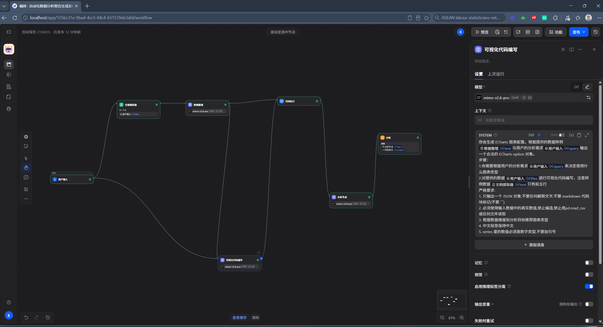
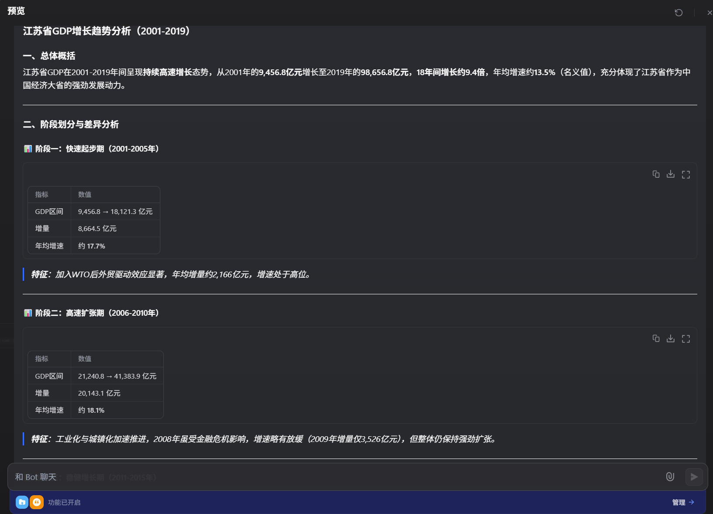
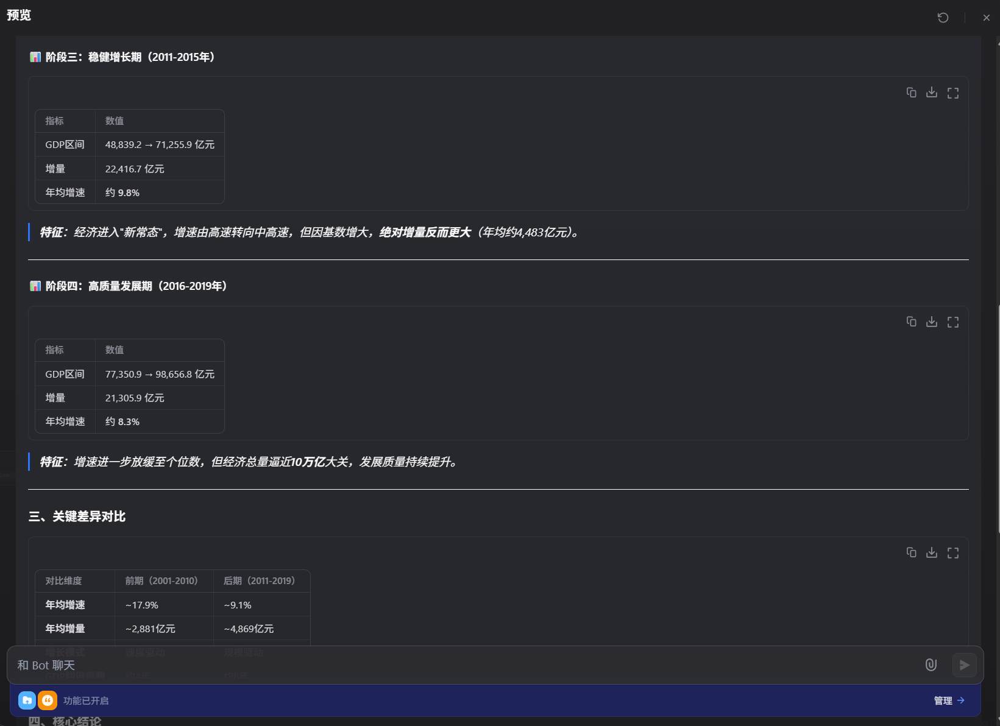
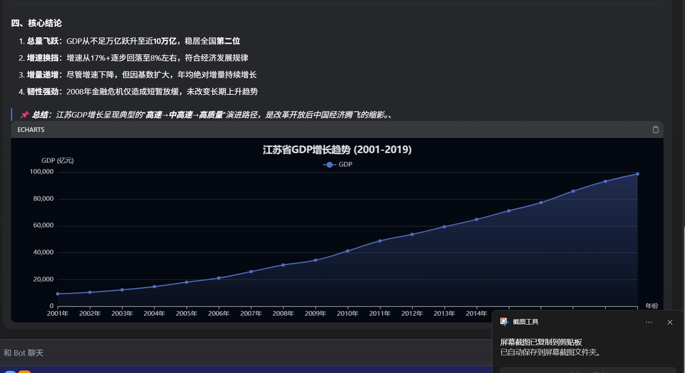

# agent_learn

Agent 学习与实践作品集。记录我在 AI Agent / LLM 应用方向的项目实践、踩坑笔记与经验总结。

## 项目列表

| 项目 | 技术栈 | 状态 |
|------|--------|------|
| [自动化数据分析报告系统](#自动化数据分析报告系统) | Dify · Chatflow · ECharts · MySQL | 🚧 持续迭代中 |

---

## 自动化数据分析报告系统

基于 Dify Chatflow 搭建的自动化数据分析智能体：用户用自然语言提问，系统自动查询数据库、生成 ECharts 交互式图表，并输出对图表的文字分析，最终以"先图表、后分析"的顺序流式呈现。

### 功能特性

- **自然语言查数据**：NL2SQL，用户提问自动转为 SQL 查询（只读账号，安全隔离）
- **自动可视化**：LLM 生成 ECharts option JSON，代码节点自动清洗（去 markdown 围栏 / 思考残渣 / 引号修复），前端渲染交互式图表
- **图表解读**：LLM 基于图表配置与完整数据生成文字分析
- **有序输出**：图表 → 分析内容按顺序流式输出

### 演示

**工作流全景**（Dify Chatflow 节点编排）：



**报告输出效果**（图表 + 自动分析）：







### 架构

```
用户提问
   │
   ▼
数据整理 ──► LLM 生成 ECharts JSON ──► 代码节点清洗
   │                                      │
   │                                      ▼
   │                              直接回复（```echarts 图表```）
   │                                      │
   ▼                                      ▼
                       LLM 图表分析 ──► 直接回复（分析文本）
```

### 技术要点

- 渲染 ECharts 必须用 Chatflow 的「直接回复」节点 + ` ```echarts ` 代码块（Workflow 类型不渲染）
- 代码节点做"清洗"不做"执行"：`json.loads` + `ast.literal_eval` 兜底处理 LLM 输出的不规范 JSON
- 同一消息内图表与分析混排时，历史消息重解析易导致围栏配对错乱、图表加载失败——分析文本需清洗反引号
- 数据节点需传完整数据，摘要式输入会让图表只能覆盖部分实体

更多踩坑记录见 [docs/dify-可视化工作流踩坑记录.md](docs/dify-可视化工作流踩坑记录.md)

### 运行方式

1. 部署 Dify（docker compose）
2. 在 Dify 中导入 `dify/` 目录下的 DSL 文件
3. 配置模型 API Key 与数据库连接即可运行

---

## 联系

欢迎交流 Agent / LLM 应用方向的实践经验。
